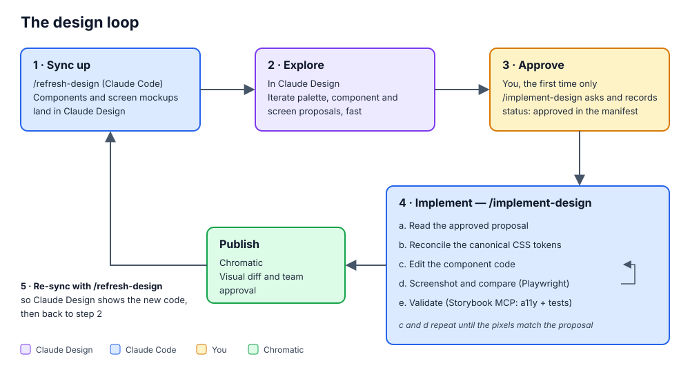

# Design Studio Plugin

The `design-studio` plugin runs a **design ↔ Storybook/Chromatic** iteration loop against a React or
React Native codebase. You explore look-and-feel in a **local design studio** (a Docker container
serving your repo's `design/` folder: no account, nothing leaves the machine), then a Claude Code
session implements the version you picked in your real components — grounded in your design tokens,
verified with Playwright screenshots and Storybook tests, and published to Chromatic for team review.

[Claude Design](https://claude.ai/design) is the secondary backend: the same loop, with the
exploration in a Claude Design project instead of the studio. See
[the plugin README](../plugins/design-studio/README.md) for both.



## The pieces

| Piece | Role |
|-------|------|
| `init-design-studio` | One-time setup: picks the backend, runs the setup skills below, captures the components into `design/`, starts the studio, offers the companion skills, writes the manifest. |
| `design-palette` | Creates or normalizes the canonical theme palette — the **source of truth** for design tokens — and audits its contrast. |
| `storybook-init` | Installs Storybook, wires the Storybook MCP server, and confirms Playwright can screenshot stories. |
| `chromatic-init` | Adds Chromatic visual testing (optional publish and approval gate). |
| `/open-design-studio` | Starts or opens the project's studio and registers its MCP server. |
| `design-in-studio` | Designs from a brief: the `designer` agent writes versions of a component or screen proposal. |
| `sketch-in-studio` | Makes a studio wireframe real (**Make real**), through the `designer` agent. |
| `designer` (agent) | Writes studio versions with the project's tokens and components only, then screenshots each in light, dark and at 320px and fixes what fails its interface checks. |
| `implement-design` | Implements the proposal in React, converging on screenshots and tests, then publishes to Chromatic. |
| `refresh-design` | Re-captures the references that are behind their code, and adds screens. |

The shared contract every skill relies on — the manifest schema, the backends, the approval signal,
and the token-reconciliation rules — lives in
`plugins/design-studio/references/design-contract.md`.

## Prerequisites

- **Node.js 22.18+** (the palette generator) and a package manager.
- An existing **React** or **React Native** project, with Storybook (or let `init-design-studio`
  add it).
- **Docker**, and a checkout of this repository: the studio is `apps/design-studio`.
- Optional: a **Chromatic** account for the publish gate.
- Optional, recommended: five interface skills from
  [jakubkrehel/skills](https://github.com/jakubkrehel/skills) that the `designer` agent preloads
  (`better-layout`, `better-typography`, `better-ui`, `better-accessibility`, `better-writing`).
  `init-design-studio` offers the install command. `better-colors` stays out: its palette rules
  conflict with the project's palette, and the plugin's `color-usage.md` keeps its usage and
  contrast rules.

## Installation

The plugin ships in the `lichens-ai-dev-tools` marketplace.

### From the marketplace (recommended)

```bash
# Clone and register the marketplace once
git clone https://github.com/Lichens-Innovation/ai-dev-tools.git
claude plugin marketplace add ./ai-dev-tools

# Install the plugin
claude plugin install design-studio@lichens-ai-dev-tools
```

Then invoke its skills as usual: `/init-design-studio`, `/design-in-studio`, `/implement-design`, etc.

### Local (for development on the plugin)

```bash
claude --plugin-dir ./plugins/design-studio
```

See [plugins](./plugins.md) and [marketplace](./marketplace.md) for the general install,
enable/disable, and update mechanics.

## Workflow

### Set up the project (once)

```
/init-design-studio
```

Run it from the project root and choose the local studio. It detects what is already there and is
safe to re-run. It creates the palette, Storybook (with its MCP server and Playwright) and
optionally Chromatic. Then it captures every mapped component from Storybook into `design/` as a
**reference**, starts the studio, registers the studio MCP, and offers the companion skills.

### The design loop (repeat per change)

```
  1. CAPTURE    /refresh-design          references from Storybook and the running app into design/
  2. EXPLORE    in the studio            versions b, c… of a page's proposal, three ways:
                  /design-in-studio <page> <brief>   the designer agent writes and checks them
                  Wireframe + Make real               /sketch-in-studio, through the designer agent
                  by hand                             the palette, token swaps, precise edits
  3. PICK       Use this version         the version you keep becomes the proposal (a)
  4. IMPLEMENT  /implement-design        Claude Code implements the proposal in React
  5. PUBLISH    implement-design pushes to Chromatic for team visual review
  6. RESTART    /refresh-design re-captures what changed, back to step 2
```

**Exploring (step 2).** A page's proposal is a realistic HTML view, version **a**. Every way of
exploring writes a new version next to it, so nothing is lost: compare them in the studio's page
bar. `/design-in-studio settings-screen a denser layout` has the `designer` agent write two
distinct versions by default; `/design-in-studio settings-screen refine c calmer` reworks one. The
agent uses only the project's tokens and components, writes layout rather than coordinates,
screenshots each version in light, dark and at 320px, and fixes what fails its checks (accessible
names, visible focus, clipping, contrast in both modes, color as the only signal, destructive
actions, truncation, scroll cues, reduced motion) before reporting what it changed and decided.

**What `implement-design` does (step 4):**

1. Reads the manifest and finds the proposals that changed since they were last implemented (a
   content hash). The first time, it asks whether to implement one and records `status: approved`.
2. Diffs the proposal against its reference: the `<style data-studio>` rules and the DOM changes.
3. **Reconciles** the values into your canonical tokens (snapping to existing semantic tokens by
   default; asking before inventing new ones).
4. Edits the component, then **converges visually**: screenshots the stories with Playwright and
   compares them with the studio's render of the proposal, in both modes, until they match.
5. **Validates** with the Storybook MCP (accessibility and interaction tests).
6. **Publishes** to Chromatic and records the implemented hash in the manifest.

### The approval signal

Approval is durable, versioned state — not a chat message. Picking a version (**Use this
version**) makes it the proposal; `implement-design` records `status: "approved"` on its entry in
`design.manifest.json` (committed to the repo) the first time. After that, each new edit of the
proposal is picked up without asking again.

### Token reconciliation

The canonical palette wins for both values and structure. A proposal only uses tokens; when it
needs one the palette lacks, the default (`reconcileRule: "canonical-wins"`) snaps it to the
nearest existing semantic token and asks before adding a new one. Set `reconcileRule: "extend"` in
the manifest to have new values added as tokens automatically. Either way, the semantic layer
(e.g. `--color-primary`) is preserved, so one token change propagates to every component.

## Roles at a glance

| Piece | Job in the loop |
|-------|-----------------|
| **Design studio** | Local exploration: references, proposals, versions, wireframes, the palette. |
| **Studio MCP** | Claude's access to the studio: read and write pages, the palette, Make real requests. |
| **`designer` agent** | Writes and checks versions from a brief or a wireframe. |
| **Storybook MCP** | Knowledge + validation (props, changed stories, a11y/interaction tests). Does **not** screenshot. |
| **Playwright** | The eyes — the pixels the designer checks and `implement-design` converges against. |
| **Canonical palette** | Single source of truth for token values and structure. |
| **Chromatic** | Team-facing regression and approval gate. |
| **`design.manifest.json`** | Durable mapping + approval state tying design pages to local components. |
