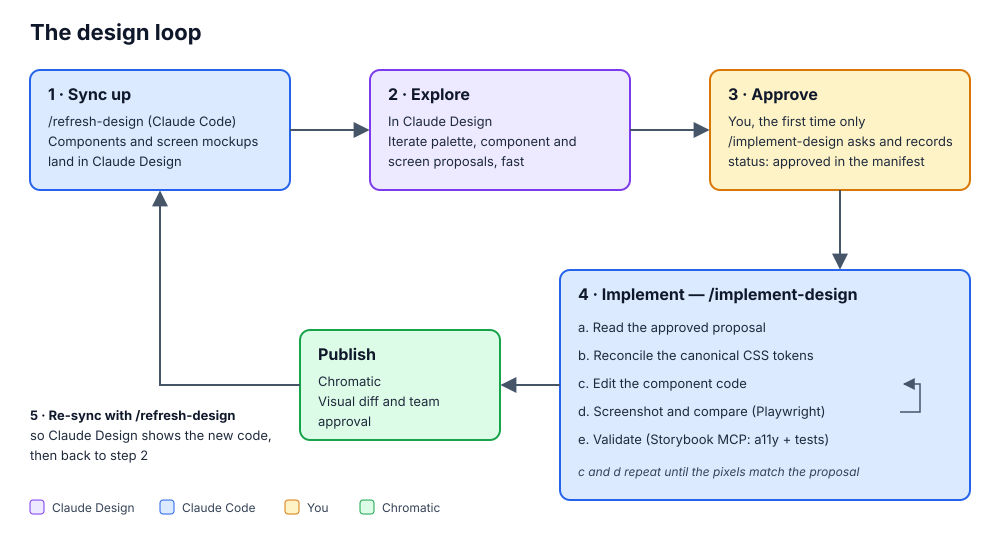

# design-studio

A plugin for running a **design ↔ Storybook/Chromatic** design-iteration loop against a React or React Native codebase:

- **Local design studio** (primary): you explore in a studio that runs on your machine in Docker, on a `design/` folder of your repo: references captured from your Storybook and app, proposals designed by the plugin's `designer` agent from a brief, drawn as wireframes, or edited by hand. No account, nothing leaves the machine.
- **Claude Design** (secondary): you explore inside a [Claude Design](https://claude.ai/design) project instead.

Then a Claude Code session implements the version you picked in your real components — grounded in your design tokens, verified with Playwright screenshots and Storybook tests, and published to Chromatic.

The backend is chosen once, in `/init-design-studio`, and recorded as `backend` (`"local"` or `"claude-design"`) in `design.manifest.json`. A project without `backend` is a Claude Design project, as before. To move a project to the other backend later, run `/switch-design-backend` (see [Switching backend](#switching-backend)).



## What's inside

- **Skills**: `init-design-studio`, `design-in-studio`, `sketch-in-studio`, `implement-design`, `refresh-design`, `switch-design-backend`, `design-studio-help`, and the setup sub-skills `design-palette`, `storybook-init`, `chromatic-init` ([Skills](#skills)).
- **Agent**: `designer`, which writes and checks studio versions for `design-in-studio` and `sketch-in-studio` ([Agent](#agent)).
- **Command**: `/open-design-studio` ([Commands](#commands)).
- **References**: the shared contract, the local studio, the backends, and `color-usage.md` (how a page uses the palette).

## Prerequisites

Both backends need Node 22.18+ (the palette generator), Playwright (installed by `/storybook-init`) and a Storybook for the components.

### Local backend

- Docker, to run the studio (one container per project, on `127.0.0.1` only).
- A checkout of this repository (ai-dev-tools): the studio is `apps/design-studio` in it. `/open-design-studio` finds it from the plugin's own location, or from `AI_DEV_TOOLS_DIR`.
- `@faker-js/faker` next to Playwright (`init-design-studio` installs it): screen captures replace the app's personal data with fakes, redact the selectors a screen row lists in `anonymize.redact`, and fail on any email, phone or token left over. See [`local-studio.md`](./references/local-studio.md#sample-data).
- **Optional, recommended**: five interface skills from [jakubkrehel/skills](https://github.com/jakubkrehel/skills) (MIT), which the `designer` agent preloads. `/init-design-studio` offers them; to install them yourself, run in Claude Code:

  ```
  ! npx skills add jakubkrehel/skills -a claude-code -s better-layout -s better-typography -s better-ui -s better-accessibility -s better-writing -y
  ```

  Leave out `better-colors` (and turn it off if the `interfaces` plugin is installed): its palette rules conflict with the project's palette. Its usage and contrast rules are in [`color-usage.md`](./references/color-usage.md). Without the five skills the agent still works, with less guidance on layout, type and copy.
- Nothing else: no Claude Design MCP, DesignSync or `/design sync`.

### Claude Design backend

Make sure that you have the Claude Design MCP installed and Claude Code's DesignSync enabled:

1. Install the Claude Design MCP: `claude mcp add --scope user --transport http claude-design https://api.anthropic.com/v1/design/mcp`
2. In Claude Code, run `/design-login`
3. Check in `/plugins` that the MCP connection is successful; if not, select the MCP and reconnect.
4. Check that `/design sync` is listed. The plugin uses the built-in DesignSync tool to create the design-system project and to upload the palette card. If only `/design consent` and `/design revoke` show up, look in the project's `.claude/settings*.json` for:
   - `"DesignSync"` in `permissions.deny`: remove it.
   - `"disableBundledSkills": true`: set it to `false`, and turn off the bundled skills you do not want with `skillOverrides` (`"<skill>": "off"`).

   Then start a new session.

## Installation

In Claude Code, run `/init-design-studio`. It asks which backend (the local studio, or Claude Design), checks the prerequisites of that backend and what the project already has (Tailwind, Storybook, Chromatic), asks before changing anything, treats Tailwind and Chromatic as optional, and reviews an existing Storybook for the loop. It runs `/storybook-init` and `/chromatic-init` for you; run
those directly only to (re)configure one piece.

With the local backend it also creates `design/`, captures every mapped component from its Storybook, starts the studio, registers its MCP server and offers the companion skills.

## Usage

### Local design studio

1. `/open-design-studio` starts the project's studio (or opens it when it runs) and registers the `design-studio` MCP server at project scope (commit the `.mcp.json` it writes). `/open-design-studio rebuild` rebuilds the image after you update the ai-dev-tools checkout. In a sandboxed Claude Code session, Docker can't run inside the sandbox: the command offers to add its four exact `docker compose` calls to `sandbox.excludedCommands` in `.claude/settings.local.json` (nothing broader), or gives you the calls to run with `!`.
2. In the studio, open a component and **Create proposal**. The proposal is a realistic HTML view of the component, version **a**. Explore from there; each way writes a new version (B, C… in the page bar), so nothing you like is overwritten:
   - **`/design-in-studio <page> <brief>`**: the `designer` agent writes versions from your brief (two by default, each a distinct direction), with your tokens and components only, screenshots each in light, dark and at 320px, and fixes what fails its interface checks (accessible names, focus, clipping, contrast, color as the only signal) before it reports. `/design-in-studio <page> refine c …` reworks one version.
   - **Wireframes and Make real**: see step 4.
   - **By hand**: the palette in the footer, a token swap on a picked element in its Inspect tab, or a precise change you ask Claude for.

   **Use this version** on the one you want makes it the proposal (a).
3. Run `/implement-design`. It only implements the proposal (a). The first time it finds a proposal it asks whether to implement it and records `status: approved`; it diffs the proposal against its reference (the `<style data-studio>` rules and the DOM changes), implements it, converges on screenshots of the studio's render of the proposal, and writes `lastImplementedHash`.
4. **Wireframes and Make real.** To try things yourself, open the page's **Wireframes** view: a new wireframe is generated from a version of the page in Excalidraw (or starts blank), and you move, resize, retext, delete and draw. **Make real** (the selection or the whole wireframe) has the `designer` agent write it as a new alternate version of the proposal (`/sketch-in-studio`), checked like the versions of `/design-in-studio`: B, C… in the page bar. **Use this version** on the one you want makes it the proposal that `/implement-design` implements. Start Claude Code with `claude --dangerously-load-development-channels plugin:design-studio@lichens-ai-dev-tools` and the request arrives in the session by itself; without the flag, the studio's **Copy command** gives `/sketch-in-studio <id>` to paste. **New blank page** in the sidebar starts a component or screen from a wireframe alone. See [`local-studio.md`](./references/local-studio.md#wireframes-and-make-real).
5. After a code change, `/refresh-design` tells you which references are behind their code (the component's sources or story changed since capture) and re-captures them. It refuses to overwrite a reference someone edited. `/refresh-design add the Home page` captures a screen from the running app: **that snapshot contains whatever data the dev app shows, and `design/` is committed**, so capture on seeded sample data ([`references/local-studio.md`](./references/local-studio.md#sample-data)).

### Claude Design

In Claude Design, change the palette card, or ask for a proposal of a component change
(`proposals/<name>.html`, see [`references/proposals.md`](./references/proposals.md)), then in
Claude Code run `/implement-design`. The first time it finds a proposal it asks whether to implement
it and records `status: approved` in `design.manifest.json`; after that, each new edit of the
proposal is picked up without asking again.

To design a whole page, bring it in first: `/refresh-design add the Home page` (or tell
`/implement-design` to). It rebuilds the page as a mockup from the synced components, checked against
the running app, with no change to the app ([`references/screens.md`](./references/screens.md)).
Propose changes in `proposals/screens/<name>.html` and approve them like a component.

Run `/refresh-design` to bring Claude Design up to date with the code (implement-design offers it
after implementing): it tells you when the components are behind their code (then run
`/design-sync`, which only you can start), and rebuilds the mockups whose screen changed.
After updating the design-studio plugin, it also offers the newer `palette.ts`, proposal conventions,
navbar and cards (`design.manifest.json` records the plugin version the project is at).

### Switching backend

Run `/switch-design-backend` to move a set-up project from Claude Design to the local studio, or back:

1. It lists the proposals not implemented yet and offers to stop so you run `/implement-design` first. They are not carried over: a Claude Design proposal and a studio page do not translate, so they stay in the old backend.
2. It shows how `design.manifest.json` will change and asks before writing it. The palette, components and screens keep their code side (files, stories, sources, routes). Their design paths become the new backend's, and every item goes back to `wip` with no implemented hash.
3. Leaving local, it offers to stop the studio container and remove the `design-studio` MCP server. `design/` stays unless you ask to delete it. Leaving Claude Design, the Claude Design project is left as it is.
4. Then run `/init-design-studio`: it sets up the new backend (for local: `design/`, the captures and the studio; for Claude Design: the project, the palette card and `/design sync`). Add screens back with `/refresh-design add the <name> page`.

## Skills

| Skill            | Role                                                                                                                                                                                                                                                                                                                                                                                                  |
| ---------------- | ----------------------------------------------------------------------------------------------------------------------------------------------------------------------------------------------------------------------------------------------------------------------------------------------------------------------------------------------------------------------------------------------------- |
| `init-design-studio`    | One-time setup orchestrator for an existing React or React Native project. Asks which backend (Claude Design or the local studio), runs the setup sub-skills below and verifies the result. For the local backend it creates `design/`, installs `@faker-js/faker` next to Playwright, captures the components and starts the studio.                                                                                                                  |
| `design-palette` | Creates or migrates the canonical theme palette (light/dark inputs → scales → semantic tokens), generates one theme shared by web and React Native plus namespaced Tailwind utilities (`text-noa-muted`) or Sass names (`$text-muted`), carries hand-authored spacing, type and breakpoint tokens for projects without Tailwind, copies the generator (`palette.ts`, Node 22.18+) into the repo with a `palette` package script, audits contrast, and provides a live palette card for Claude Design that edits the colors, the hand-authored token values and, in its Advanced view, which token each semantic token points to. Used by `init-design-studio`. |
| `storybook-init` | Installs Storybook, wires the Storybook MCP server, and confirms Playwright can screenshot stories. Used by `init-design-studio`.                                                                                                                                                                                                                                                                            |
| `chromatic-init` | Adds Chromatic visual testing (the publish/approval gate). Runs after `storybook-init`. Used by `init-design-studio`.                                                                                                                                                                                                                                                                                        |
| `design-in-studio` | Local backend. Designs from a brief: the `designer` agent writes one or more alternate versions of a component or screen proposal (or reworks one), with the project's tokens and components, checks each in both modes and at 320px, and reports. The user picks one with **Use this version**. A precise edit is written directly. |
| `implement-design`    | The runtime skill. Reads an approved component or screen proposal (or the palette) from the project's backend, Claude Design or the local studio, and implements it in React, converging via screenshots + tests, then pushes to Chromatic. Routes page and refresh requests to `refresh-design`.                                                                                                     |
| `refresh-design` | The one skill for updating the backend from the code. Local studio: reports which captured references are behind their code and re-captures them. Claude Design: says when the components need a `/design-sync`, rebuilds stale screen mockups, offers new screens, and adds a named page or fixes a mockup, checked against screenshots of the running app. After a plugin update it brings the project's copies of the plugin's files (`palette.ts`, the proposal conventions in the design-sync readme header, the navbar, the palette and Tailwind cards) up to date, keeping the card's data and the project's wording; `implement-design` runs the same check before implementing.                         |
| `sketch-in-studio` | Local backend. Makes a studio wireframe real: reads the Make real request (the compact wireframe and a PNG, through the studio MCP), has the `designer` agent write it as a new alternate version of the page's proposal, and resolves the request. Arrives through the plugin's channel or as `/sketch-in-studio <id>`. |
| `switch-design-backend` | Moves a set-up project to the other backend (Claude Design ↔ local studio): checks for unimplemented proposals, rewrites the manifest for the new backend, and hands over to `init-design-studio` to set it up. Run it yourself. |
| `design-studio-help` | Shows this README in the browser, or in the console with `/design-studio-help console`. Run it yourself. |

## Agent

| Agent      | Role |
| ---------- | ---- |
| `designer` | Local backend. Writes studio versions through the studio MCP for `design-in-studio` and `sketch-in-studio` (never app code), from the page, the palette and its contrast audit, the reusable components and [`color-usage.md`](./references/color-usage.md); preloads the companion skills when installed. Then screenshots each version in light, dark and at 320px, fixes the blockers (accessible names, focus, clipping, contrast, color alone, destructive actions, truncation, scroll cues, reduced motion), and reports what it changed, decided and could not verify. |

## Commands

| Command          | Role                                                                                                                                                              |
| ---------------- | ----------------------------------------------------------------------------------------------------------------------------------------------------------------- |
| `/open-design-studio` | Local backend. Starts or opens the project's studio container (finding the ai-dev-tools checkout itself) and registers the `design-studio` MCP server once, at project scope. `rebuild` rebuilds the image. |

## The contract

All the skills agree on one shared contract — the manifest schema, the Claude Design ↔ local mapping, the approval signal, and the token-reconciliation rules. See [`references/design-contract.md`](./references/design-contract.md). Read it before changing any skill.

The skills never branch on the backend: they call five named operations (List targets, Fetch target, Stage render, Check references, Refresh references; contract §8), and each backend implements them in its own doc: [`references/backends/claude-design.md`](./references/backends/claude-design.md) (DesignSync and the `ds-bundle` steps) and [`references/backends/local.md`](./references/backends/local.md) (`local-backend.mjs` and `capture.mjs`). The local files and the sample-data rule are in [`references/local-studio.md`](./references/local-studio.md).
